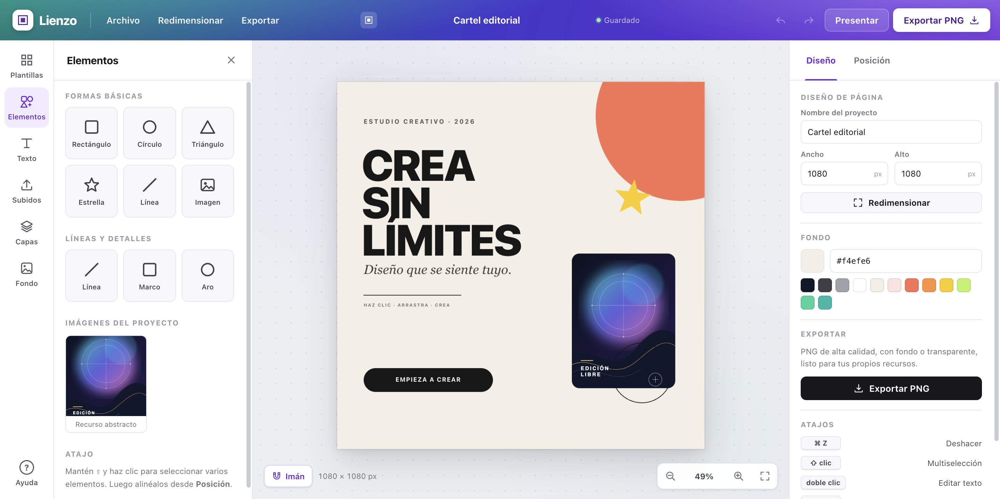
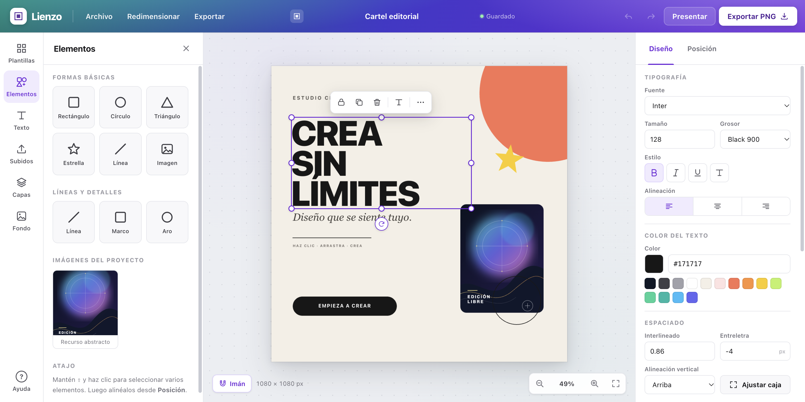
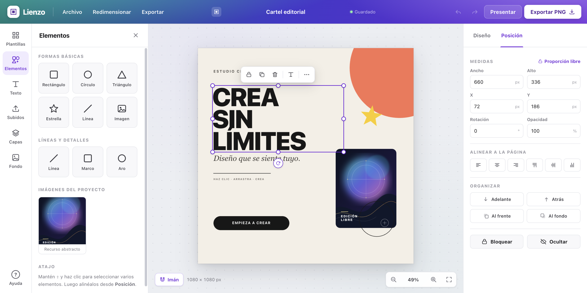
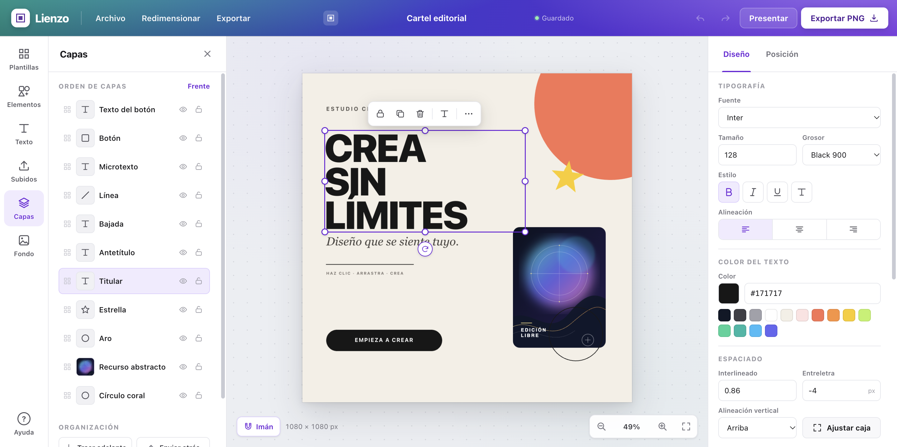
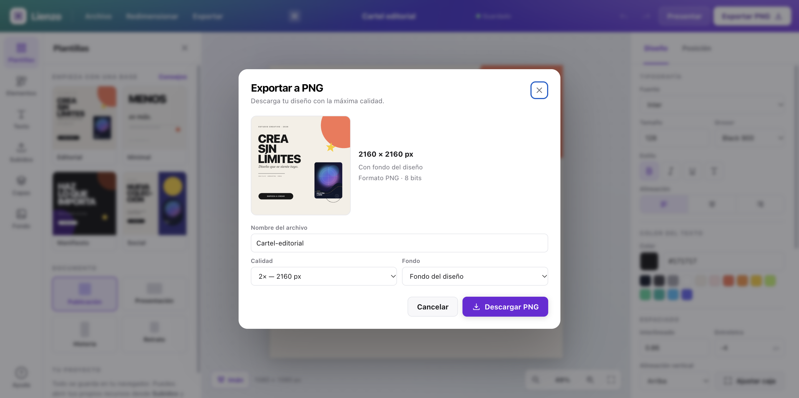

# Lienzo — editor de diseño gráfico

Clon funcional e independiente de un editor tipo Canva, construido tras una investigación con
REA de los flujos públicos de **selección, movimiento, redimensionado, rotación, organización,
tipografía, color, deshacer y exportación** de Canva.

No usa frameworks, dependencias externas, fuentes descargadas ni recursos de Canva. Funciona
offline en el navegador y guarda el proyecto en `localStorage`.



## Arranque

**Opción rápida (macOS):** doble clic en **`Abrir Lienzo.command`**. El lanzador inicia el
servidor local si hace falta y abre la aplicación en el navegador.

**Opción manual:**

```bash
cd /Users/javier/Desktop/CLON
npm start
```

Luego abre <http://127.0.0.1:4173>.

> No abras `index.html` con doble clic: la aplicación usa módulos ES y necesita servirse por
> HTTP. El lanzador o `npm start` ya se encargan de eso.

## Subir el proyecto a un repositorio

No hay que ejecutar ningún archivo de la aplicación para subirla: se usa **Git** sobre la
carpeta. La forma más simple es crear un repositorio vacío en GitHub/GitLab y hacer doble clic
en **`Subir a repositorio.command`**; el lanzador inicializa Git, crea el commit, pide la URL del
repositorio y lo sube.

También se puede hacer manualmente:

```bash
cd /Users/javier/Desktop/CLON
git init
git add .
git commit -m "Lienzo: editor de diseño gráfico"
git branch -M main
git remote add origin https://github.com/TU-USUARIO/TU-REPO.git
git push -u origin main
```

El repo debe crearse vacío (sin README) para evitar conflictos. Se sube todo el proyecto:
`index.html`, `styles.css`, `js/`, `server.mjs`, `package.json`, `docs/` y los lanzadores. No se
sube `node_modules` (el proyecto no tiene dependencias), `.DS_Store` ni logs.

> `docs/evidence/` contiene capturas de la interfaz pública de Canva y pesa unos 28 MB. Si el
> repositorio va a ser público y querés uno más liviano, podés excluir esa carpeta o comprimir
> las capturas; la documentación principal sigue funcionando.

## Funciones

- **Selección:** clic, ⇧ clic, marquesina y teclado; objetos bloqueados y ocultos.
- **Transformación:** arrastrar, 8 manejadores de redimensionado, rotación, pasos de 15° con ⇧,
  medidas numéricas, proporción fija.
- **Ajuste magnético:** bordes y centros de la página y de otros objetos, con guías.
- **Organización:** capas, visibilidad, bloqueo, reordenamiento, adelante/atrás/frente/fondo,
  alineación a página o selección, distribución.
- **Tipografía:** 16 familias, tamaño, peso, negrita, cursiva, subrayado, mayúsculas, alineación,
  interlineado, espaciado.
- **Color:** relleno, trazo, texto y fondo; selector nativo, hexadecimal y paletas.
- **Texto en el sitio:** doble clic, edición directa, ajuste automático de altura.
- **Imágenes propias:** subida y arrastre, reemplazo, cover/contain, volteo, redondeo.
- **Historial:** 80 estados, undo/redo con agrupación de gestos.
- **Exportación PNG:** 1×/2×/3×, fondo transparente, vista previa y nombre de archivo.
- **Proyecto:** autoguardado, JSON de ida y vuelta, 4 plantillas originales, cambio de tamaño de
  página, modo presentación.

## Capturas

| | |
|---|---|
|  |  |
| Selección con 8 manejadores y barra contextual. | Medidas, alineación y orden de capas. |
|  |  |
| Capas, visibilidad y bloqueo. | Exportación PNG con calidad y transparencia. |

## Documentación

- [Investigación REA: qué se observó en Canva](docs/INVESTIGACION-REA.md)
- [Implementación: arquitectura, algoritmos y verificación](docs/IMPLEMENTACION.md)
- [Guía de uso y atajos](docs/GUIA-DE-USO.md)
- [Índice de evidencias](docs/evidence/README.md)

## Estructura

```
index.html        UI y sprite de iconos
styles.css        sistema visual y layout
server.mjs        servidor estático local sin dependencias
js/
  app.js          arranque, atajos, exportación, diálogos
  store.js        documento, historial, capas, autoguardado
  model.js        modelo, hit-testing, plantilla inicial
  render.js       render Canvas 2D y texto
  interactions.js selección, move, resize, rotate, texto inline
  snapping.js     guías y ajuste magnético
  ui.js           paneles e inspector
  templates.js    cuatro plantillas originales
  util.js         utilidades, fuentes, paletas
docs/             investigación, implementación, guía y evidencias
```

## Verificación

- `node --check` sobre los 9 módulos: OK.
- Chrome 154, carga y recarga sin errores de consola.
- Arrastre, resize (660×336 → 495×253), rotación (−31°) y undo verificados.
- Multiselección y alineación verificadas.
- Subida de un SVG 400×300 como recurso propio verificada.
- Exportación PNG 2160×2160 (655 111 bytes) y transparencia (alfa 0) verificadas.

Detalle completo en [IMPLEMENTACION.md](docs/IMPLEMENTACION.md#7-verificación-realizada).

## Alcance y límites

Este es un **clon funcional**, no una copia del producto ni de sus activos. No incluye nube,
colaboración, IA, edición de nodos vectoriales, recorte interactivo ni múltiples páginas. La
investigación se hizo sobre la interfaz pública en modo invitado y está documentada con sus
límites en [INVESTIGACION-REA.md](docs/INVESTIGACION-REA.md#5-límites-de-la-observación).

Canva es una marca de Canva Pty Ltd. Lienzo no está afiliado a Canva.
